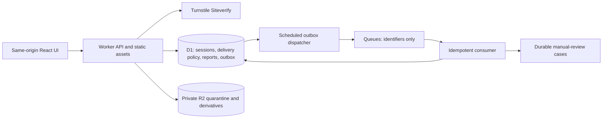

# Prayer Box backend integration and launch

Status: implementation has started; local and synthetic only. The stack is **Cloudflare Workers + D1 + private R2 + Queues + Turnstile**. There is no Zapier dependency. GitHub remains source control, and the existing GitHub Pages site remains the fictional design preview.

The founder authorized backend development. This increment does not open sign-up, create Cloudflare resources, deploy a backend, connect paid services, collect real prayers, or accept donations. The production budget is still unpriced; the preview's zero-cost donation state is not a production hosting estimate.

## Architecture and first increment



The backend build retains the current soft blue/pastel surfaces, logo, typography and submission feedback. Its first connected UI is a private feedback form, attachments and in-app receipt notifications. It does not import the prototype's example accounts or prayers. The prototype remains a separate build.

| Area | Implemented in this increment | Still required before real use |
| --- | --- | --- |
| Identity | Hashed session lookup, expiry/revocation/account-epoch checks, origin and CSRF checks, logout | Maintained sign-in provider, enrollment, recovery, MFA and proof of recovery semantics |
| Privacy | D1 delivery/post/reply boundaries; current approval and block checks; anonymous DTO allowlists; protected GET routes | Authorized creation/update/delete and membership commands, consent/version records, audit trail, complete API/UI migration |
| Bot protection | Server Siteverify; exact hostname/action; timeout/failure denial; bounded JSON; per-account rate counters | Real widget/domain/secret, edge abuse controls, accessible staffed recovery/help process and provider outage drill |
| Feedback | Authenticated, idempotent database submission; durable triage jobs; owner-only reads | Staff interface, assignment/resolution and operational response policy |
| Media | PNG/JPEG/WebP screenshot admission, private quarantine, bounded upload, manual hold, authorized derivative gateway | Safe decoding/normalization, metadata stripping, malware/content screening, derivative provenance, staffed appeals; audio/video remain disabled |
| Jobs and notices | Transactional outbox, IDs-only transport, lease/duplicate/retry protection, failure cases, private in-app notices | Production queues/alerts, operator dashboard, retention/reconciliation jobs, full prayer/care jobs |
| Operations | Local configuration, migrations, runtime tests and GitHub check workflow | Separate staging/production resources, restore drill, secret lifecycle, monitoring, incident procedures and launch approval |

## Identity and recovery contract

The account requirement permits a username and password without requiring an email address or telephone number. Provider selection must prove that exact behavior, rather than inventing an address or quietly making contact information mandatory. No password verification or recovery endpoint is implemented by this increment.

Before selecting a provider, demonstrate username uniqueness and safe normalization, enumeration-resistant sign-in/recovery, password/session protections, optional verified contact methods, and usable single-use recovery codes for people without contacts. Prove atomic consumption of recovery codes, session-epoch invalidation after recovery, session revocation and administrative MFA. Keep the provider's subject mapping internal. Do not put provider tokens in local storage or URLs.

Production sessions use a Secure, HttpOnly, SameSite cookie scoped to the application origin. The local-only session fixture uses an HTTP localhost cookie. Mutation requests require the trusted Origin and a session-bound CSRF token. MFA and a recent authentication event are required for sensitive administrative commands; no browser-supplied role or membership field can grant access.

The checked-in configuration refuses requests to non-loopback hosts while `APP_ENV=local`. There is no development-login endpoint. Creating a public configuration requires deliberate new environment bindings and an identity implementation, not changing a browser toggle.

## Server-enforced prayer privacy and church membership

An internal authored source can have multiple independent deliveries. Each delivery owns its own posts, replies, attachments and audience. A personal copy never inherits church replies, and adding another box never copies a private conversation. The API returns only allowlisted presentation fields; anonymous readers never receive author IDs, source IDs, other delivery IDs, private acknowledgments or identifying profile links.

Owners cannot submit to their own personal or organization box; ordinary approved church members can submit to a church they do not own. Private personal deliveries are available to the sender and intended recipient. Church delivery access requires currently approved membership and a current active account. An invitation, pending application, friendship, visible organization page or official-reply badge does not grant membership. Revoked membership loses subsequent API/media access. Assignment organizes work without narrowing the approved-member audience. Public and friends views must satisfy all author, box and delivery privacy ceilings and block rules.

Every update and reply is scoped to an exact delivery and story post. Foreign keys prevent a reply or media item from pointing into another box's post. Screening status and deletion are checked on reads. Writes will additionally need transactional authorization and revision checks. Private acknowledgments remain author-only and explicitly automatic; they must never falsely claim that a human has read or prayed over a request.

Two policy choices remain pending: whether newly approved church members see retained history, and how account blocking interacts with organization-wide membership access. The local fixtures explicitly exercise both history policies. The provisional `hold_on_conflict` fixture withholds the whole organization copy when a member/author block conflicts with group access; it is not a founder-approved production decision. Real organization intake stays closed until the notice, consent and policy are settled.

## Bot verification, admission and accessible help

The server calls the fixed Siteverify endpoint and requires `success: true`, the expected action, and an exact allowed hostname. The client cannot assert success. Missing configuration, reused/expired tokens, a provider outage, malformed replies and wrong hostname/action all fail closed. A failed verification preserves the draft and offers retry/help; the Help page does not silently bypass the checker.

Feedback JSON is limited to 16 KiB and 3,000 message characters, with a 20-second body-read deadline. Screenshot body reads have a 60-second deadline. Only the category, body and verification token are accepted. Five new verification attempts per account per ten-minute fixed window limit this initial flow. Uploads use their own account limit and a hard per-report cap. These application limits supplement, rather than replace, production edge/request-volume controls. The exact production limits and identity/IP risk policy require traffic measurements and an accessibility review.

Idempotency keys are scoped to the authenticated account. The request hash excludes the transient bot token, so a retry cannot create a duplicate report or conflict merely because the widget renewed. Changed content with the same key is rejected. Each report and its durable job are committed together. The upload endpoint requires a current session and ownership of an already accepted report; it does not open a separate anonymous upload channel.

Before launch, provide an actually staffed support route and a documented independently verified alternative for users who cannot complete the widget. Do not invent a fallback contact address or use a client-side bypass. Test keyboard, screen-reader, blocked-script, expired-token, slow-network and provider-outage paths.

## Private media, screening, appeals and care

The current upload scope is feedback screenshots only: up to three pictures, each at most 5 MiB, in PNG/JPEG/WebP format. Streaming byte limits and basic signature checks reject obviously invalid formats. These checks are not malware screening or safe image normalization. Originals are stored privately under unpredictable quarantine keys and are never served by the media endpoint.

The gateway only permits approved, separately named `normalized/` derivatives after current ownership or exact-post authorization. It ignores Range and serves a full bounded image with private/no-store headers. There is no public bucket, public object URL, direct client storage credential or presigned download. No current worker can approve an upload; without a qualified scanner/normalizer, the durable job creates a manual-review hold. Neither the existence of a case nor a successful upload means staff have reviewed it.

The next media migration must record the derivative's own content type, byte length, digest, source revision, scanner/version and disposition. The pipeline must decode safely, enforce pixel/frame/duration budgets, strip metadata, isolate processing, screen text/OCR/transcripts/frames as applicable, and publish only the approved immutable derivative. Audio/video remain off until this exists for those formats. R2 and D1 are not one transaction: reconcile orphan objects and missing references; never delete a potentially committed object after an ambiguous database failure.

Reports, spam detection, money-solicitation checks and appeals need stable reason codes, evidence tied to an exact revision, human decisions, auditing and staff access limited to the case. Appeals must not require reposting content publicly. Validated reports can become a curated, consent/retention-reviewed evaluation set; never automatically retrain on every report or send private prayers to a model vendor without an approved data-processing policy.

Care requests remain separate from abuse violations. Mentioning self-harm must offer relevant professional support without automatically penalizing or publicly labeling the person. Prayer-team, moderation and care roles are separate. No reviewer has general private-inbox access by default. Staff the queues, document safeguarding and escalation boundaries, verify regional help resources, and disclose that Prayer Box is not monitored as an emergency service. Keep Christian encouragement alongside practical support and the confirmed Trinitarian foundation: one God, Father, Son and Holy Spirit. The companion About copy remains proposed where it has not been approved.

## Durable notifications and operational delivery

Workers commit an outbox row in the same D1 transaction as the originating report. A scheduled dispatcher sends only the job ID. Queue delivery may repeat or arrive out of order; the consumer uses durable leases, guarded writes and unique effects. A duplicate must not create duplicate notices or override a completed job. Expired leases can be retried. Exhausted processing attempts and transport failures are visible as durable review cases; operators must monitor and resolve them.

Notifications are stored privately and rechecked against the current owning resource before display. Deleted resources and inactive recipients do not generate usable notices. Initial notices contain generic receipt/status wording, not prayer text. Email, SMS, web push, external bug trackers and Zapier are not connected. A later integration must have explicit destination consent, sanitized payloads, idempotency and verified real delivery.

## Local development and source control

Use Node 24 and the pinned lockfile. No real credentials are required for the tests.

```sh
npm ci
npm run backend:types
npm run backend:check
npm run backend:test:check
npm run backend:policy
npm run backend:build
npm run backend:test
npm run backend:migrate
npm run backend:seed
npm run backend:dev
```

Open `http://localhost:8787/`. Browser asset requests to the emulator’s displayed `127.0.0.1` address redirect to this canonical origin; API mutation Origin checks stay exact. The seed helper writes a one-hour synthetic session to ignored `output/backend-local/session.json`; it never creates a real account or exposes a token in a public login route. The browser starts signed out. API tests install synthetic sessions directly in their isolated local databases. Missing Turnstile configuration correctly disables UI submission; runtime tests inject deterministic Siteverify responses at the handler seam, not through a production request parameter.

Wrangler does not automatically run scheduled handlers locally. After a synthetic accepted report, trigger the local dispatcher at `http://localhost:8787/cdn-cgi/local/scheduled` to exercise receipt delivery; runtime tests exercise the actual local Queue binding as well. Production dispatch is configured for every five minutes, and latency should be measured before choosing a pilot interval.

`backend:dry-run` validates the bundle without deploying. Every migration is append-only once shared. Never edit an applied migration to fix live data. Separate staging and production D1/R2/Queue bindings, a proper custom application origin, secrets and an approved deployment workflow are future work. The all-zero local database identifier is deliberately not a provisioned resource.

The backend GitHub workflow runs type generation/checks, local runtime tests, policy tests, frontend checks and a dry-run bundle. It has read-only repository permissions and no deployment credentials. GitHub Pages continues to build the prototype on main. Backend work is reviewed on a `codex/` branch before merging. Do not commit `.dev.vars`, `.env` files, local databases, token fixtures, uploaded screenshots, founder briefs or private evidence.

## Verification and launch sequence

| Gate | Required evidence before advancing |
| --- | --- |
| 1. Local foundation | Real Workers-runtime tests with local D1/R2, deny-by-default privacy matrix, duplicate/race tests, failure/retry tests, independent review, both frontend builds and visual inspection |
| 2. Identity and policy proof | Chosen provider and recovery/MFA tests; approved membership history/block policy, age/region rules, retention, consent wording and role responsibilities |
| 3. Staging text flow | Isolated provisioned resources; real auth/Turnstile; request/update/reply/delete and membership commands; source-to-delivery isolation; post-specific conversations; audited moderation/appeals; real staff queues |
| 4. Operations readiness | Named owners, measurable queue/error alerts, support route, privacy/terms, access reviews, secret rotation, deletion/tombstone jobs, staging load tests and restore exercise |
| 5. Limited pilot | Explicit founder release approval, consented testers, verified end-to-end delivery, actual moderation/prayer/care staffing and incident response; text-only if media is unfinished |
| 6. Public launch | Pilot findings resolved, final accessibility/security review, forecast costs and operational capacity approved; payments remain separately gated |

Stress tests must be bounded to isolated synthetic environments. Cover cross-account/direct-ID access, exact-post and organization boundaries, revoked/expired sessions, stale membership, block/privacy changes, concurrent idempotency requests, upload size/type/cap races, malformed/chunked/slow requests, queue duplication/reordering, partial provider outages and resource exhaustion. Record throughput, latency, rejected traffic, costs and unresolved findings. Local tests do not establish production capacity or constitute a penetration-test certification.

Backups must cover D1 and R2 together. Define recovery-point and recovery-time objectives, backup retention and permitted operators, then restore into a quarantined environment and reconcile objects, source revisions and deletion tombstones before enabling access. D1 Time Travel is useful but does not restore R2 or undo external messages. Test data recovery and application rollback separately. Suspend intake and queue delivery if an incident could violate privacy; do not roll back data to resurrect revoked membership or deleted prayers.

Enable structured metrics for error categories, latency, verification failures, queue age/retries/dead letters and storage growth. Do not log session tokens, credentials, raw bodies, anonymous identity mappings or media URLs. Invocation logging is disabled in the local configuration; traces and any future provider logs still require a privacy review. Set cost/usage alarms before enabling uploads or processors. Establish a staffed on-call route and rehearse a provider outage, stolen-session response, erroneous disclosure and backup restoration.

## Primary technical references

- [Turnstile server-side validation](https://developers.cloudflare.com/turnstile/get-started/server-side-validation/): server validation, token lifetime/reuse and result fields.
- [Workers static-asset SPA routing](https://developers.cloudflare.com/workers/static-assets/routing/single-page-application/): explicit Worker-first API/media paths with SPA assets.
- [Workers local development](https://developers.cloudflare.com/workers/local-development/): local bindings and execution boundaries.
- [Workers Vitest integration](https://developers.cloudflare.com/workers/testing/vitest-integration/): actual Workers-runtime tests and local resource bindings.
- [D1 migrations](https://developers.cloudflare.com/d1/reference/migrations/), [read replication and sessions](https://developers.cloudflare.com/d1/best-practices/read-replication/), and [Time Travel](https://developers.cloudflare.com/d1/reference/time-travel/).
- [Queues delivery guarantees](https://developers.cloudflare.com/queues/reference/delivery-guarantees/) and [dead-letter queues](https://developers.cloudflare.com/queues/configuration/dead-letter-queues/).
- [R2 public buckets](https://developers.cloudflare.com/r2/buckets/public-buckets/): public access is deliberately not configured for private attachments.
